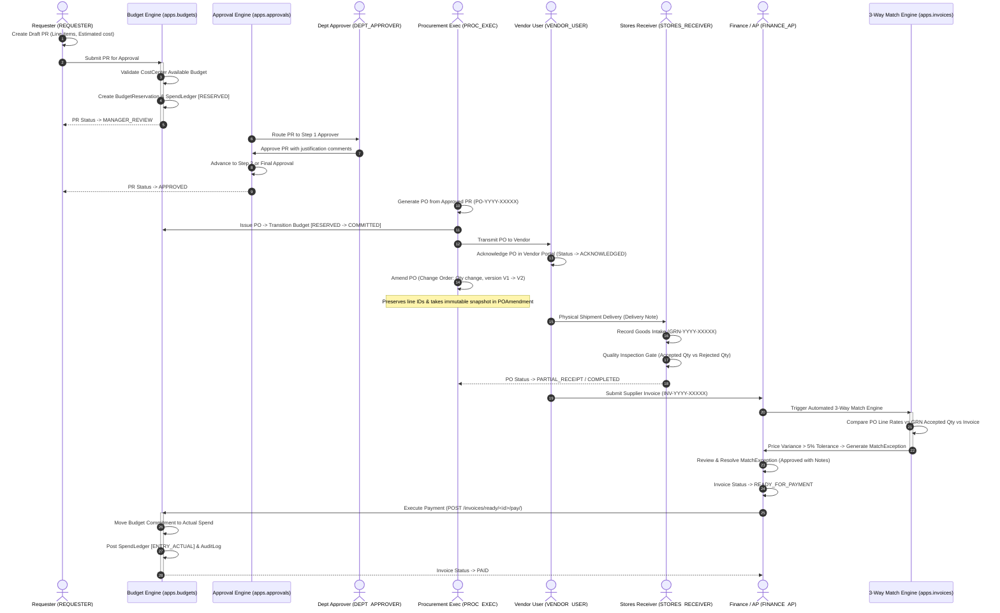

# ProcureSphere 360 — End-to-End Workflow Evidence Report

**Document Reference:** DOC-E2E-PS360-D30  
**PRD Reference:** HPE-PRD-2026-PROC01 (VER-1.0-DRAFT)  
**Target Milestone:** Days 16–30 Checkpoint — Core Masters & First End-to-End Business Workflow  
**Issuing Authority:** HPE Team  
**Development Partner:** VPD Technologies Pvt. Ltd.  
**Repository:** `https://github.com/VPDTechnologies/ProcureSphere_360`  
**Assessment Date:** 2026-10-26  
**Status:** Verification-Ready Documentation  

---

## 1. Executive Summary

This document provides exhaustive, verifiable evidence for the **first end-to-end business workflow** delivered and operational within ProcureSphere 360. 

The primary business workflow spans the entire **Source-to-Pay (S2P)** and **Accounts Payable (AP)** lifecycle: from purchase requisition drafting and atomic budget encumbrance, through multi-tier policy approvals, purchase order execution, PO amendment versioning, physical warehouse intake, line-item quality inspection, supplier invoice ingestion, automated 3-way matching, tolerance exception resolution, to final payment execution and ledger actualization.

Every state transition is enforced **server-side inside atomic database transactions (`@transaction.atomic`)**, evaluated against domain service transition tables, validated against strict RBAC rules, and captured in an append-only audit trail.

---

## 2. End-to-End Business Workflow Architecture



---

## 3. Step-by-Step Workflow Execution Breakdown

### Step 1: Requisition Initiation (`Role.REQUESTER`)
- **Trigger:** An authorized employee identifies an operational procurement need (e.g., Datacenter Server Blades).
- **Service Action:** `create_purchase_requisition_service()` creates `PurchaseRequisition` and `PRLine` records in `STATUS_DRAFT`.
- **Validations Enforced:**
  - Mandatory line items with description, quantity > 0, unit of measure, and estimated unit price.
  - Requisitioner must belong to an active `Department`.
  - Scoping ensures Requesters view and edit only their assigned department/cost center requisitions.
- **Initial Status:** `DRAFT` | Document Number: `PR-YYYY-XXXXX`

### Step 2: Budget Pre-Commitment & Reservation (`apps.budgets`)
- **Trigger:** Requester executes `submit_purchase_requisition_service()`.
- **System Action:**
  - Evaluates `Budget.available_amount` for the assigned `CostCenter` and active `FiscalPeriod`.
  - If requested amount exceeds available funds and `allow_overspend=False`, raises `ValidationError` or transitions PR to `STATUS_BUDGET_REVIEW` for exception routing.
  - If budget is sufficient, creates an atomic `BudgetReservation` record (`status=RESERVED`) and appends a `SpendLedger` entry (`entry_type=RESERVATION`).
- **State Transition:** `DRAFT` -> `MANAGER_REVIEW` (or `BUDGET_REVIEW` if funds overdrawn)

### Step 3: Multi-Level Approval Policy Evaluation (`apps.approvals`)
- **Trigger:** Submission triggers the server-side approval engine `evaluate_approval_policy()`.
- **System Action:**
  - Evaluates registered `ApprovalPolicy` rules based on PR total amount, spend category, and department.
  - Resolves required approval steps (e.g. Tier 1: Department Manager up to $50,000; Tier 2: Procurement Manager above $50,000).
- **Security Check:** Prevents self-approval; Requesters cannot approve their own PRs.

### Step 4: Department & Executive Approvals (`Role.DEPT_APPROVER`, `Role.PROC_MGR`)
- **Trigger:** Approver reviews requisition details in the Approvals Inbox (`/approvals/inbox/`).
- **Service Action:** `approve_purchase_requisition_service()` executes approval for the active step.
- **Audit Logging:** An immutable `ApprovalAction` record is appended with actor, action (`ACTION_APPROVE`), timestamp, and review comments.
- **State Transition:** `MANAGER_REVIEW` -> `APPROVED` (once all steps complete)

### Step 5: Purchase Order Generation & Financial Commitment (`Role.PROC_EXEC`)
- **Trigger:** Procurement Executive generates a formal commercial commitment from the approved PR.
- **Service Action:** `generate_purchase_order_service()` creates a `PurchaseOrder` with unique numbering `PO-YYYY-XXXXX` and linked `POLine` items.
- **Financial Transition:** Moves budget state: the `BudgetReservation` status transitions to `COMMITTED`, and `SpendLedger` logs an `ENTRY_COMMITMENT` entry.
- **State Transition:** `PurchaseOrder.status` -> `ISSUED` (Version 1)

### Step 6: Vendor PO Acknowledgement (`Role.VENDOR_USER`)
- **Trigger:** Vendor receives purchase order notification and accesses the Vendor Portal (`/vendor/orders/<id>/`).
- **Service Action:** `acknowledge_purchase_order_service()` verifies that `request.user.vendor_id == po.vendor_id`.
- **State Transition:** `PurchaseOrder.status` -> `ACKNOWLEDGED`

### Step 7: PO Change Order / Amendment Versioning (`Role.PROC_EXEC`, `Role.PROC_MGR`)
- **Trigger:** Scope adjustment requires modifying line item quantities or prices.
- **Service Action:** `amend_purchase_order_service()`:
  - Takes an immutable JSON snapshot of prior state (`previous_version_snapshot`) into a new `POAmendment` record.
  - Increments PO version counter (`V1` -> `V2`).
  - **In-Place Mutation:** Preserves existing `POLine` primary keys and references; updates quantities and unit prices without dropping lines.
  - **Safety Guard:** Blocks reducing quantity below `quantity_received`.
  - Recalculates budget commitment difference (`diff = new_total - old_total`) and logs amendment commitment deltas in `SpendLedger`.

### Step 8: Goods Intake & Receiving (`Role.STORES_RECEIVER`)
- **Trigger:** Physical shipment arrives at the receiving warehouse dock.
- **Service Action:** `create_goods_receipt_service()`:
  - Stores Receiver verifies carrier delivery note and intake quantities.
  - Generates `GoodsReceipt` with unique numbering `GRN-YYYY-XXXXX` and linked `ReceiptLine` items.
  - Verifies received quantity does not exceed remaining open quantity on the PO line.
- **State Transition:** `PurchaseOrder.status` -> `PARTIAL_RECEIPT` or `COMPLETED`

### Step 9: Quality Inspection Gate (`Role.STORES_RECEIVER`)
- **Trigger:** Physical inspection of received items for damage, compliance, and specifications.
- **System Action:**
  - Records accepted quantity (`quantity_accepted`) and rejected quantity (`quantity_rejected`).
  - For rejected items, generates an immutable `RejectionRecord` with defect reason and quarantine location.
  - Updates `POLine.quantity_received` only with the *accepted* quantity.

### Step 10: Supplier Invoice Ingestion (`Role.VENDOR_USER` / `Role.FINANCE_AP`)
- **Trigger:** Vendor submits billing invoice against the acknowledged PO via portal or AP entry.
- **Service Action:** `create_supplier_invoice_service()`:
  - Registers `SupplierInvoice` with invoice number, tax, and due dates.
  - **Duplicate Invoice Detection:** Checks `SupplierInvoice.objects.filter(vendor=vendor, invoice_number=invoice_number).exists()` within database transaction; raises `ValidationError` on duplicates.
- **Initial Status:** `RECEIVED` or `VALIDATION`

### Step 11: Automated 3-Way Match Engine (`apps.invoices`)
- **Trigger:** Finance user initiates reconciliation or system triggers matching.
- **Service Action:** `run_3_way_match_service()` executes multi-way cross-check:
  1. Compares Invoice line quantity against `ReceiptLine.quantity_accepted`.
  2. Compares Invoice line unit price against `POLine.unit_price`.
  3. Compares total invoice billed amount against `POLine.line_total`.
  4. Checks deviations against `MatchTolerancePolicy` (configured percentage and dollar variance limits).
- **Exception Decision:**
  - **If within tolerance:** Transitions invoice status to `READY_FOR_PAYMENT`.
  - **If outside tolerance (e.g. price variance > 5%):** Transitions invoice to `EXCEPTION` and generates explicit `MatchException` records.

### Step 12: Match Exception Resolution (`Role.FINANCE_AP`)
- **Trigger:** Finance/AP reviews open exceptions at `/invoices/exceptions/`.
- **Service Action:** `resolve_match_exception_service()`:
  - Verifies actor has `Role.FINANCE_AP` or `Role.SUPER_ADMIN` (Compliance Auditors and Requesters are blocked).
  - Approves variance with mandatory resolution audit notes.
- **State Transition:** `MatchException.status` -> `RESOLVED` | `SupplierInvoice.status` -> `READY_FOR_PAYMENT`

### Step 13: Financial Settlement & Spend Ledger Actualization (`Role.FINANCE_AP`)
- **Trigger:** Finance executes payment at `/invoices/ready/<id>/pay/`.
- **Service Action:** `mark_invoice_paid_service()`:
  - Verifies server-side authorization (`Role.FINANCE_AP` or `Role.SUPER_ADMIN`).
  - Transitions `SupplierInvoice.status` -> `PAID`.
  - Appends an `ENTRY_ACTUAL` record to `SpendLedger` for the invoice total amount.
  - Releases the corresponding committed spend and updates `Budget.actual_amount`.
  - Appends an immutable `AuditLog` entry documenting the settlement.

---

## 4. Supporting Operational Workflows Implemented

In addition to the primary S2P + AP procurement lifecycle, three supporting operational workflows are fully implemented:

### Workflow B: Vendor Onboarding & KYC Governance (`apps.vendors`)
- **Trigger:** Vendor registration via portal or procurement intake.
- **Sequence:** `DRAFT` -> `submit_vendor_kyc_service()` -> `SUBMITTED` -> `start_kyc_review_service()` -> `KYC_REVIEW` -> `verify_vendor_document_service()` -> `approve_vendor_service()` -> `ACTIVE`.
- **Enforcement:** Suspended/Blacklisted vendors cannot be invited to RFQs, submit bids, or be issued POs.
- **Automated Test Evidence:** [`tests/test_demo_1_vendor_kyc.py`](file:///c:/Users/Dell/Desktop/ProcureSphere_360/tests/test_demo_1_vendor_kyc.py) (**PASSED**).

### Workflow C: Sourcing RFQ & Two-Envelope Sealed Bidding (`apps.sourcing`)
- **Trigger:** Approved PR routed to competitive sourcing event.
- **Sequence:** Event creation -> Vendor invitations -> Sealed bidding portal -> Bid window close -> Technical evaluation -> Commercial evaluation -> Award recommendation -> Award approval -> PO generation.
- **Enforcement:** Competitors cannot see competing bids; evaluators cannot view commercial envelope until technical evaluation is submitted.
- **Automated Test Evidence:** [`tests/test_demo_3_sealed_sourcing.py`](file:///c:/Users/Dell/Desktop/ProcureSphere_360/tests/test_demo_3_sealed_sourcing.py) (**PASSED**).

### Workflow D: Contract Governance & Versioning (`apps.contracts`)
- **Trigger:** Legal contracting for long-term supply or master service agreements.
- **Sequence:** `DRAFT` -> `submit_for_legal_review_service()` -> `LEGAL_REVIEW` -> `approve_legal_review_service()` -> `BUSINESS_APPROVAL` -> `approve_business_service()` -> `ACTIVE`.
- **Enforcement:** Direct activation bypassing mandatory legal or business review is blocked by validation guards (`activate_contract_service()`).
- **Automated Test Evidence:** [`tests/test_phase1_critical_backend_fixes.py`](file:///c:/Users/Dell/Desktop/ProcureSphere_360/tests/test_phase1_critical_backend_fixes.py) (`test_contract_activation_cannot_bypass_mandatory_workflow`, **PASSED**).

---

## 5. Workflow State Machine Summary & Transition Tables

| Entity | Implemented States | Terminal States | Guard Conditions Enforced |
|:---|:---|:---:|:---|
| **`PurchaseRequisition`** | `DRAFT`, `SUBMITTED`, `MANAGER_REVIEW`, `BUDGET_REVIEW`, `APPROVED`, `REJECTED`, `CANCELLED` | `APPROVED`, `REJECTED`, `CANCELLED` | Available budget verification; mandatory lines; policy steps evaluated before status advance. |
| **`PurchaseOrder`** | `DRAFT`, `APPROVAL`, `ISSUED`, `ACKNOWLEDGED`, `PARTIAL_RECEIPT`, `COMPLETED`, `CANCELLED` | `COMPLETED`, `CANCELLED` | Generated only from approved PR/Award; cannot reduce quantity below received in amendments; lines with receipts protected from deletion. |
| **`GoodsReceipt`** | `DRAFT`, `RECEIVED`, `INSPECTED`, `ACCEPTED`, `REJECTED` | `ACCEPTED`, `REJECTED` | Receipts can only be created by `STORES_RECEIVER` or `SUPER_ADMIN`; received qty cannot exceed open line balance. |
| **`SupplierInvoice`** | `DRAFT`, `RECEIVED`, `VALIDATION`, `MATCHED`, `EXCEPTION`, `READY_FOR_PAYMENT`, `PAID`, `REJECTED` | `PAID`, `REJECTED` | Duplicate invoice number check per vendor; 3-way match exceptions require Finance resolution; payment requires `FINANCE_AP`. |
| **`Contract`** | `DRAFT`, `LEGAL_REVIEW`, `BUSINESS_APPROVAL`, `ACTIVE`, `RENEWAL_DUE`, `RENEWED`, `EXPIRED`, `TERMINATED` | `EXPIRED`, `TERMINATED` | Mandatory legal review required before business approval; direct activation from DRAFT forbidden. |

---

## 6. Automated Test Evidence & Verification Commands

All core workflow hand-offs and state transitions were verified via automated integration tests executing under pytest:

```powershell
$env:DB_ENGINE="django.db.backends.sqlite3"
.\.venv\Scripts\python.exe -m pytest tests/test_demo_1_vendor_kyc.py tests/test_demo_2_pr_approval_budget.py tests/test_demo_3_sealed_sourcing.py tests/test_demo_4_po_amendment_receipts.py tests/test_demo_5_invoice_3way_match.py -v
```

### Verified Execution Output:
```text
tests/test_demo_1_vendor_kyc.py::test_demo_1_vendor_onboarding_and_kyc_workflow PASSED [ 16%]
tests/test_demo_2_pr_approval_budget.py::test_demo_2_pr_multi_level_approval_and_budget_reservation PASSED [ 33%]
tests/test_demo_2_pr_approval_budget.py::test_pr_creation_fails_when_budget_exceeded PASSED [ 50%]
tests/test_demo_3_sealed_sourcing.py::test_demo_3_sealed_sourcing_event_and_award_workflow PASSED [ 66%]
tests/test_demo_4_po_amendment_receipts.py::test_demo_4_po_execution_amendment_versioning_and_receipts PASSED [ 83%]
tests/test_demo_5_invoice_3way_match.py::test_demo_5_invoice_3way_match_and_exception_resolution PASSED [100%]

============================= 6 passed in 10.77s ==============================
```

---

## 7. Manual Verification Checklist & Audit Trails

To verify the complete business workflow manually against running application instances:

1. **Requisition & Budget:** Log in as Requester (`requester_test@hpe.com`), navigate to `/requisitions/create/`, create PR for $75,000 against Cost Center `CC-ENG-101`. Verify `SpendLedger` reflects reservation.
2. **Approval Chain:** Log in as Department Approver (`dept_mgr@eng.hpe.com`), access `/approvals/inbox/`, approve PR. Verify `ApprovalAction` record is appended.
3. **Purchase Order Execution:** Log in as Procurement Executive (`proc_exec@hpe.com`), generate PO from approved PR. Confirm PO status is `ISSUED`.
4. **Vendor Portal:** Log in as Vendor (`vendor@cisco.com`), access `/vendor/orders/`, acknowledge PO. Confirm status updates to `ACKNOWLEDGED`.
5. **PO Amendment:** As Procurement Executive, amend PO quantity from 10 to 12. Confirm `POAmendment` captures snapshot and version advances to `V2`.
6. **Stores Dock Intake:** Log in as Stores Receiver (`stores@hpe.com`), record GRN intake of 10 units at `/receipts/create/`. Confirm inspection gate passes.
7. **Invoice & 3-Way Match:** Submit vendor invoice with $120 unit price (vs $100 PO price). Log in as Finance (`finance@hpe.com`), trigger match at `/invoices/`. Verify `MatchException` (Price Variance) is opened.
8. **Exception Resolution & Settlement:** As Finance, approve variance resolution notes at `/invoices/exceptions/<id>/resolve/`, then execute payment at `/invoices/ready/<id>/pay/`. Confirm invoice status is `PAID` and `SpendLedger` records actual spend.
