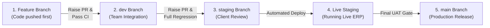
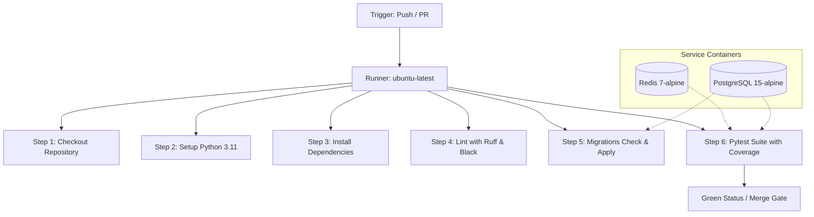

# ProcureSphere 360 — Continuous Integration (CI) Baseline Configuration

**Document Reference:** CI-BASE-PS360-D15  
**PRD Reference:** HPE-PRD-2026-PROC01 (VER-1.0-DRAFT)  
**Target Milestone:** Days 1–15 Engineering Foundation & CI Baseline  
**Active Workflow Path:** `.github/workflows/ci.yml`  
**Date of Assessment:** 2026-10-12  

---

## 1. Overview & Purpose

Continuous Integration for ProcureSphere 360 is configured as an automated gatekeeper hosted on GitHub Actions. It validates code formatting, static analysis, database migration consistency, and comprehensive pytest test coverage across all domain modules before any branch can be merged into `dev`, `staging`, or `main`.

The CI configuration is designed to:
1. Prevent defective code, unformatted files, or broken migrations from entering protected branches.
2. Provide reproducible, containerized test execution with isolated PostgreSQL and Redis service containers.
3. Eliminate secret leakage by relying on dedicated, isolated test credentials and GitHub Actions secret bindings.
4. Execute fast, targeted linting on changed Python files while enforcing complete regression testing across the entire codebase.

---

## 2. Workflow Triggers, Branch Strategy & Promotion Lifecycle

The primary CI workflow is defined in [`.github/workflows/ci.yml`](file:///C:/Users/Dell/Desktop/ProcureSphere_360/.github/workflows/ci.yml) and is triggered on:

```yaml
on:
  push:
    branches: [ main, dev, staging, "feature/**", "features/**", "bugfix/**" ]
  pull_request:
    branches: [ main, dev, staging ]
```

### 2.1 Branch Strategy Alignment:
- **`main`:** Production-ready releases only. Protected branch requiring approved PR and green CI.
- **`staging`:** Integration environment for coordinator and stakeholder acceptance testing. **The staging branch is live** and hosts the running application for milestone review and demo verification.
- **`dev`:** Active shared integration branch for daily development and cross-module synchronization.
- **`feature/**` & `features/**`:** Dedicated topic branches for modular development (e.g., `features/legal_manager`). Push events trigger CI validation automatically.
- **`bugfix/**`:** Dedicated hotfix and defect resolution branches.

### 2.2 End-to-End Code Promotion & Deployment Flow (Feature → Dev → Staging → Live)

The development and deployment lifecycle follows a strict, multi-stage code promotion progression:



1. **Step 1: Push Code to Feature Branch First (`feature/**` / `features/**`)**
   - All new module implementations, bugfixes, and code files are pushed directly into the dedicated feature branch first (e.g., `features/legal_manager`).
   - Pushing to the feature branch automatically triggers the GitHub Actions CI pipeline to validate code formatting (Ruff, Black), migration integrity, and isolated test suites before any pull request is reviewed.

2. **Step 2: Raise a Pull Request to Development (`feature/**` → `dev`)**
   - Once the feature implementation is complete and passes all local and feature-branch CI checks, the developer raises a Pull Request from the feature branch targeting the shared `dev` integration branch.
   - Peer reviews and automated CI merge gates ensure that incoming code does not introduce regressions or conflict with concurrent module changes.

3. **Step 3: Raise a Pull Request from Development to Staging (`dev` → `staging`)**
   - As multi-module milestone capabilities stabilize on `dev`, a promotion Pull Request is raised from `dev` targeting the `staging` branch.
   - The PR to `staging` undergoes comprehensive integration testing, full migration verification from zero, and Technical Lead approval.

4. **Step 4: Live Staging Environment (`staging` is Live)**
   - Upon merging into `staging`, the code is automatically deployed to the **live staging environment**.
   - Staging represents the live, database-backed demonstration ERP where coordinators, clients, and auditors inspect working end-to-end workflows (PRDs, KYC, Sourcing, POs, Receipts, Invoices, and Contracts) on real PostgreSQL data before final production release.

---

## 3. Workflow Architecture & Service Containers

The workflow defines a single unified job (`lint-and-test`) executing on `ubuntu-latest` with containerized dependency services.



### Service Container Specifications:
1. **PostgreSQL Service:**
   - **Image:** `postgres:15-alpine`
   - **Database Name:** `procuresphere_test_db`
   - **User / Password:** `procure_user` / `procure_password`
   - **Port:** `5432:5432`
   - **Healthcheck:** `pg_isready` (interval: 10s, timeout: 5s, retries: 5)
2. **Redis Service:**
   - **Image:** `redis:7-alpine`
   - **Port:** `6379:6379`
   - **Healthcheck:** `redis-cli ping` (interval: 10s, timeout: 5s, retries: 5)

---

## 4. Pipeline Execution Steps

### Step 1: Repository Checkout
```yaml
- uses: actions/checkout@v4
  with:
    fetch-depth: 0
```
*Purpose:* Fetches full git commit history to enable differential comparison (`git diff`) between the feature branch and target branch (`dev` / `staging`).

### Step 2: Python Environment Setup
```yaml
- name: Set up Python 3.11
  uses: actions/setup-python@v5
  with:
    python-version: "3.11"
    cache: "pip"
```
*Purpose:* Provisions Python 3.11 runtime and caches pip dependencies for faster job execution.

### Step 3: Dependency Installation
```yaml
- name: Install dependencies
  run: |
    python -m pip install --upgrade pip
    pip install -r requirements.txt
```
*Purpose:* Reproducibly installs all pinned production and test dependencies defined in `requirements.txt`.

### Step 4: Differential Linting & Static Analysis
```bash
git fetch origin dev || true
if [ -n "$GITHUB_BASE_REF" ]; then
  BASE_REF="origin/$GITHUB_BASE_REF"
else
  BASE_REF="origin/dev"
fi
CHANGED_FILES=$(git diff --name-only --diff-filter=d $BASE_REF...HEAD -- "*.py" 2>/dev/null || true)
if [ -z "$CHANGED_FILES" ]; then
  CHANGED_FILES=$(git diff --name-only --diff-filter=d HEAD~1 HEAD -- "*.py" 2>/dev/null || true)
fi
if [ -n "$CHANGED_FILES" ]; then
  ruff check $CHANGED_FILES
  black --check $CHANGED_FILES
fi
```
*Purpose:* Automatically identifies all modified Python files in the pull request and verifies them against Ruff and Black rules.

### Step 5: Migration Consistency & Fresh DB Validation
```yaml
- name: Run Migrations Check
  env:
    DJANGO_SETTINGS_MODULE: config.settings.dev
    DB_HOST: localhost
    DB_NAME: procuresphere_test_db
    DB_USER: procure_user
    DB_PASSWORD: procure_password
    REDIS_URL: redis://localhost:6379/0
  run: |
    python manage.py makemigrations --check --dry-run
    python manage.py migrate
```
*Purpose:*
1. `makemigrations --check --dry-run` guarantees that no model changes exist without committed migration files.
2. `migrate` guarantees that all migrations apply cleanly from zero onto a fresh PostgreSQL instance.

### Step 6: Pytest Suite with Coverage
```yaml
- name: Run Pytest Suite with Coverage
  env:
    DJANGO_SETTINGS_MODULE: config.settings.dev
    DB_HOST: localhost
    DB_NAME: procuresphere_test_db
    DB_USER: procure_user
    DB_PASSWORD: procure_password
    REDIS_URL: redis://localhost:6379/0
  run: |
    pytest --cov=src --cov-report=term-missing
```
*Purpose:* Executes all unit, integration, and security tests against the isolated database, outputting line-by-line coverage metrics.

---

## 5. Security & Secret Protection

- **No Secrets in Repository:** Real database credentials, API tokens, and secret keys are never committed or exposed in CI logs.
- **Mock Service Credentials:** The test PostgreSQL container utilizes hardcoded mock credentials (`procure_user:procure_password`) restricted entirely to the GitHub Actions ephemeral runner network.
- **Safe Environment Variables:** Configuration is injected dynamically via `env` blocks using `config.settings.dev`.

---

## 6. Gaps & Recommendations for Post-Day 15 Enhancements

1. **Gitleaks Secret Scanning:** Add a fast pre-build step utilizing `gitleaks/gitleaks-action` to detect accidental credential commits.
2. **OpenAPI Schema Check:** Add `python manage.py spectacular --validate` to verify Swagger/OpenAPI documentation generation on every build.
3. **Artifact Upload:** Archive HTML coverage reports (`pytest-cov` HTML export) as downloadable GitHub Actions workflow artifacts.
